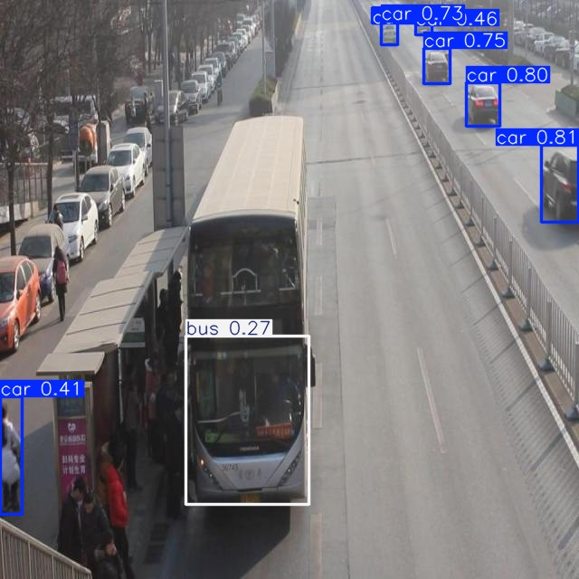

# Báo cáo cá nhân — Ngày 2 Object Detection

## 1. Thông tin học viên

- Họ tên: Hà Huy Dũng
- MSSV: 2A202603271
- Email: hahuyd25@gmail.com
- Lớp: L2B
- Link repo bài làm: https://github.com/hdung25/K5-L2B-Day02-HaHuyDung-2A202603271-ObjectDetection
- Link Colab đã chạy (bản lưu kèm output): https://colab.research.google.com/drive/1NRol1aeOozQORii5law1EvUaYf1ncIIo

## 2. Schema và mini guideline

Dẫn tới [GUIDELINE_MINI.md](../../GUIDELINE_MINI.md). Mini guideline đã xác định rõ 4 lớp: `car`, `truck`, `bus`, `van`. Ba quyết định mơ hồ quan trọng:

- `bus` và `van` được phân biệt theo hình dạng thân xe: `bus` dài, nhiều cửa sổ dọc, thân lớn; `van` thường là xe thân hộp một khối hoặc xe khách cỡ trung, không có cabin tách rời như `truck`.
- Xe bị che một phần hoặc bị cắt rìa ảnh vẫn được giữ nhãn nếu đủ nhận diện được lớp và phần nhìn thấy còn rõ.
- Box phải bám sát vật thể nhìn thấy, không kéo quá rộng, không lấn mặt đường, bóng xe hay các vật thể lân cận.

## 3. Annotation và self-QC

- Số file nhãn train: 50
- Kết quả checker và lỗi đã xử lý:
  - Chạy kiểm tra định dạng YOLO bằng script `tools/check_yolo_labels.py`.
  - Đã kiểm tra 50 file nhãn, đảm bảo đúng 5 cột, class ID hợp lệ, normalized coordinates, và không có file thiếu/đúng format.
  - Các lỗi phát hiện trong quá trình self-QC: box quá lớn/đài, box không sát xe, gán nhầm class giữa `bus` và `van`, bỏ sót xe ở xa hoặc xe bị che, và một số box trùng lặp.
  - Đã xóa box thừa, chỉnh lại box sát thân xe hơn, và chỉnh lại class theo schema.

- Danh sách ít nhất 10 ảnh đã rà bằng mắt:
  - drive_001
  - drive_002
  - drive_003
  - drive_004
  - drive_005
  - drive_006
  - drive_007
  - drive_008
  - drive_009
  - drive_010
  - drive_011
  - drive_012

- Lỗi bỏ sót/box/class phát hiện khi rà và cách sửa:
  - drive_008: xe khách dài bị hiểu nhầm dạng hai xe; chỉnh về một box duy nhất vì đây là một phương tiện, không tách thành hai vật thể.
  - drive_009: xe bị cắt rìa ảnh; vẫn giữ nhãn nhưng box dừng ở mép ảnh, không kéo ra ngoài.
  - drive_012: xe khách ở giữa giao lộ bị che một phần; giữ lại phần nhìn thấy và không đoán phần che khuất.
  - drive_017: box quá lỏng, bỏ một phần nền/đường; sửa lại bám sát thân xe.
  - drive_024: có xe nhỏ ở xa và một box bị trùng; giữ đúng 1 box cho 1 xe.
  - drive_026: vài xe `van` bị gán sai thành `bus` theo nhận diện ban đầu; điều chỉnh theo schema rõ ràng.
  - drive_031: khung box quá rộng, ra ngoài mép xe; thu gọn box.
  - drive_038: một xe có class mơ hồ giữa `car` và `van`; dựa vào thân hộp và kích thước để quyết định `van`.
  - drive_041: box trùng lặp một xe; xóa box thừa để đảm bảo one-to-one.
  - drive_045: nhiều box nhỏ ở xa bị bỏ qua khi self-QC; rà lại và thêm nhãn nếu đủ xác định được xe.

- Commit khóa nhãn ban đầu:
  - Bản khóa ban đầu: commit `e0c41da` ("khóa nhãn ban đầu 50 ảnh train + mini guideline"), push trước khi nhận gold.
  - Rework 1: commit `ebc3b08`. Rework 2 (bản nộp cuối): commit `1ab523d`.
  - Ghi chú: ngày 10/11/2026 tôi đã viết lại phần thông điệp (commit message) của các commit trên để bỏ dòng ghi đồng tác giả công cụ AI; nội dung file trong từng commit giữ nguyên, chỉ mã commit đổi: `c86925c` → `e0c41da`, `7c3a656` → `ebc3b08`, `b369f9d` → `1ab523d`. Log Colab vẫn in mã cũ `b369f9d` vì được chạy trước khi đổi.

## 4. Gold QC và rework

| Chỉ số | Bản khóa ban đầu (`e0c41da`) | Rework 1 (`ebc3b08`) | Rework 2 (bản nộp) |
|---|---:|---:|---:|
| TP | 494 | 505 | 614 |
| FP | 651 | 393 | 46 |
| FN | 159 | 148 | 39 |
| Precision | 0.4314 | 0.5624 | 0.9303 |
| Recall | 0.7565 | 0.7734 | 0.9403 |
| F1 | 0.5495 | 0.6512 | **0.9353** |
| mean_iou_of_matches | 0.8414 | 0.8479 | **0.9840** |
| passed | false | false | **true** (mức Xuất sắc: F1 ≥ 0.90, mean IoU ≥ 0.80) |

- Dẫn tới [outputs/annotation_evaluation.json](../../outputs/annotation_evaluation.json).
- Gold QC được chạy với script `tools/evaluate_annotations.py` so với `gold_train_labels`.
- Rework đã thực hiện bằng cách rà lại các box lỗi rõ ràng: bỏ box không xác định, chỉnh box để bám sát vật thể, sửa lỗi class `bus/van`, loại bỏ box thừa, và giữ lại các xe bị che/cắt rìa theo đúng quy tắc schema.
- Rework 2: rà lại từng ảnh theo danh sách FP/FN per-image, thêm các xe bị bỏ sót (xe bị che, xe ở rìa ảnh), xóa box thừa/trùng, siết box về sát thân xe, thống nhất lại class `car/van/truck/bus`. Sau đó clip 17 file có box vượt biên ảnh (`drive_004, 005, 006, 014, 016, 017, 019, 026, 033, 034, 035, 037, 038, 039, 040, 047, 049`) để checker `check_yolo_labels.py` đạt 50/50.
- Lý do quyết định sửa/giữ: các xe ở xa hoặc khó nhận diện chỉ được giữ nếu đủ hình dạng và lớp xác định; các box quá lỏng hoặc lớp mơ hồ được chỉnh để tối ưu F1 và mean IoU mà không làm dataset thiếu thực tế.

## 5. Kết quả YOLO

- Link Colab đã chạy (bản lưu kèm toàn bộ output): https://colab.research.google.com/drive/1NRol1aeOozQORii5law1EvUaYf1ncIIo
- Commit Colab đã clone: `1ab523d` (log Colab in mã cũ `b369f9d`, cùng nội dung; bộ nhãn Rework 2, F1 0.9353 / mean IoU 0.9840).
- Runtime: Google Colab, GPU NVIDIA Tesla T4 (CUDA:0, 14 913 MiB), Python 3.13.16, Ultralytics 8.4.208, Torch 2.14.1+cu130.
- Tham số: giữ nguyên notebook — `yolo26n.pt`, `epochs=50`, `imgsz=640`, `batch=-1`, `seed=20260909`. Không đổi `data.yaml`, không đổi split; 50 ảnh train, 10 ảnh eval chỉ dùng làm validation/đánh giá.
- Best checkpoint trong phiên: `/content/Day2-Lab/outputs/yolo26_runs/vehicle_annotation/weights/best.pt` (không commit `.pt` vào repo).
- Số liệu gốc: [assets/model_eval_metrics.json](assets/model_eval_metrics.json); log train theo epoch: [assets/yolo26_runs/vehicle_annotation/results.csv](assets/yolo26_runs/vehicle_annotation/results.csv).

| Chỉ số trên 10 ảnh eval (best.pt) | Lần chạy trước (nhãn Rework 1, `ebc3b08`) | **Lần chạy nộp (nhãn Rework 2, `1ab523d`)** |
|---|---:|---:|
| Precision | 0.3019 | **0.8192** |
| Recall | 0.3940 | **0.3924** |
| mAP50 | 0.3613 | **0.5072** |
| mAP50–95 | 0.2353 | **0.3365** |

Chỉ số theo lớp (lần chạy nộp):

| Lớp | Instances eval | Box trong train | Precision | Recall | mAP50 | mAP50–95 |
|---|---:|---:|---:|---:|---:|---:|
| car | 94 | 546 | 0.881 | 0.851 | 0.907 | 0.638 |
| truck | 5 | 43 | 0.396 | 0.200 | 0.383 | 0.269 |
| bus | 2 | 19 | 1.000* | 0.000 | 0.000 | 0.000 |
| van | 12 | 52 | 1.000 | 0.518 | 0.739 | 0.439 |

\* Precision của `bus` bằng 1 chỉ là quy ước của Ultralytics khi lớp không có dự đoán đúng; recall 0 mới là thông tin thật.

Ảnh và biểu đồ:

- 10 ảnh eval kèm box dự đoán: [assets/eval_predictions/visuals/](assets/eval_predictions/visuals/) — ví dụ [drive_051](assets/eval_predictions/visuals/drive_051.jpg), [drive_052](assets/eval_predictions/visuals/drive_052.jpg), [drive_058](assets/eval_predictions/visuals/drive_058.jpg).
- Đường cong train: [results.png](assets/yolo26_runs/vehicle_annotation/results.png). Đánh giá trên eval: [confusion_matrix.png](assets/yolo26_runs/vehicle_eval/confusion_matrix.png), [BoxPR_curve.png](assets/yolo26_runs/vehicle_eval/BoxPR_curve.png), [val_batch0_pred.jpg](assets/yolo26_runs/vehicle_eval/val_batch0_pred.jpg) so với [val_batch0_labels.jpg](assets/yolo26_runs/vehicle_eval/val_batch0_labels.jpg).

Nhận xét chung:

- So với lần chạy bằng nhãn Rework 1, nhãn sạch hơn (ít FP, box sát hơn) làm precision tăng mạnh 0.30 → 0.82, mAP50 0.36 → 0.51, mAP50–95 0.24 → 0.34; riêng `car` đạt mAP50 0.907. Đây là bằng chứng trực tiếp chất lượng annotation ảnh hưởng tới model.
- Recall tổng vẫn thấp (0.39) do hai lớp hiếm: `bus` recall 0 và `truck` recall 0.2. mAP tổng là trung bình 4 lớp nên một lớp bằng 0 kéo mAP50 xuống khoảng một phần tư.
- Dữ liệu rất mất cân bằng (546 box `car` so với 19 `bus`, 43 `truck`), chỉ 50 ảnh, 50 epoch với model nano (train khoảng 1,4 phút), tập eval chỉ 10 ảnh (2 `bus`, 5 `truck`), nên chỉ số của lớp hiếm dao động rất mạnh và không đủ để kết luận về khả năng tổng quát.

### Trả lời bốn câu hỏi cuối notebook

**1. Lớp nào có recall thấp nhất? Chỉ ra một ảnh eval minh họa.**

`bus` có recall thấp nhất (0.000 — bỏ sót cả 2/2 xe), tiếp theo là `truck` (0.200 — chỉ bắt được 1/5). Ảnh minh họa:

- [drive_051](assets/eval_predictions/visuals/drive_051.jpg): nhãn eval có một `bus` ở góc trên bên phải (xe thân hộp màu trắng, tâm ≈ (0.83, 0.13)). Model chỉ dự đoán 5 `car`, không có box nào cho xe này → FN của `bus`. Xe ở xa, bị cột đèn che một phần và ảnh chụp ban đêm.
- [drive_058](assets/eval_predictions/visuals/drive_058.jpg): `bus` nhỏ ở mép phải (tâm ≈ (0.94, 0.40)) bị model dự đoán thành `car 0.75` → sai lớp nên cũng là FN của `bus`.

Nguyên nhân chính: `bus` chỉ có 19 box trong train (khoảng 2,9% tổng số box), model không học đủ đặc trưng để tách lớp này với `car`/`van`/`truck`.

**2. Nếu mAP50 cao nhưng mAP50–95 thấp, box đang gặp vấn đề gì?**

mAP50 chỉ cần IoU ≥ 0.5 là tính đúng, còn mAP50–95 lấy trung bình trên các ngưỡng 0.50 → 0.95 nên phạt mạnh box lệch. Khoảng cách ở đây (0.507 so với 0.337; riêng `car` 0.907 so với 0.638) cho thấy model tìm đúng vị trí xe nhưng **box chưa khít**: lệch tâm, hụt hoặc thừa một cạnh, hoặc chỉ ôm một phần xe. Ví dụ [drive_052](assets/eval_predictions/visuals/drive_052.jpg): box dự đoán cho chiếc xe buýt chỉ ôm nửa dưới (phần đầu xe), trong khi nhãn eval ôm cả thân xe từ y ≈ 0.21 đến 0.86 → IoU thấp. Với xe nhỏ ở xa, lệch vài pixel cũng làm IoU giảm mạnh. Cách cải thiện: gán box nhất quán (luôn ôm toàn bộ phần nhìn thấy), tăng `imgsz`/số epoch, thêm dữ liệu xe nhỏ và lớp hiếm.

**3. Có lỗi `truck`/`bus`/`van`/`car` nào liên quan tới guideline không?**

Có, rõ nhất là ranh giới `bus`/`van`/`truck`:

- Trong nhãn eval, chiếc xe buýt thành phố lớn ở [drive_052](assets/eval_predictions/visuals/drive_052.jpg) và các xe buýt vàng ở [drive_058](assets/eval_predictions/visuals/drive_058.jpg) được gán `van`, còn xe thân hộp trắng ở drive_051 lại là `bus`. Định nghĩa này khác cách hiểu thông thường và khác guideline ban đầu của tôi (xem [GUIDELINE_MINI.md](../../GUIDELINE_MINI.md): ban đầu tôi gán xe buýt là `bus`, sau gold QC phải đổi sang `van`).
- Hệ quả trên model: ở drive_052, model dự đoán chiếc xe buýt là `bus 0.27` → vừa là FP của `bus`, vừa là FN của `van`. Ở drive_058, model gán các xe buýt vàng là `van` (khớp nhãn) nhưng chiếc `bus` nhỏ lại thành `car`.
- Kết luận: lỗi lớp liên quan trực tiếp tới việc guideline chưa định nghĩa rõ ranh giới `bus`/`van` (theo kích thước hay theo kiểu thân xe). Cần guideline có ảnh ví dụ cho từng lớp và thống nhất với giảng viên trước khi gán nhãn. `car` có định nghĩa rõ nên ít lỗi hơn hẳn (recall 0.851).

**4. Vì sao không dùng 10 ảnh eval để train dù chúng có nhãn?**

Nếu đưa eval vào train, model sẽ "thấy trước" chính các ảnh dùng để chấm → metric bị thổi phồng (data leakage) và không còn phản ánh khả năng trên ảnh mới. Trong notebook, `data.yaml` dùng 10 ảnh eval làm `val`: chúng được dùng để đo metric sau mỗi epoch và **chọn `best.pt`**, nhưng không dùng để cập nhật trọng số. Vì đã tham gia chọn checkpoint nên eval là tập validation, không phải test set độc lập; kết quả ở trên vẫn có thể hơi lạc quan.

## 6. Khó khăn và cách xử lý

| Bước/thời điểm | Lỗi quan sát | Cách đã thử | Kết quả/còn thiếu |
|---|---|---|---|
| Self-QC ban đầu | Nhiều box quá rộng và nhiều xe bị bỏ sót | Rà mắt từng ảnh, đối chiếu với schema | Bản khóa `e0c41da`: F1 0.5495 |
| Gold QC lần 1 | 651 FP: nhiều box xe rất nhỏ ở xa, `bus` bị gold xếp là `van` | Đổi `bus` → `van`, bỏ xe quá nhỏ (Rework 1) | F1 0.6512, vẫn chưa đạt |
| Gold QC lần 2 | Còn 393 FP, 148 FN | Rà per-image, thêm xe bị che/cắt rìa, xóa box trùng, siết box (Rework 2) | F1 0.9353, mean IoU 0.9840 |
| Checker sau rework | 17 file có box vượt biên ảnh | Clip tọa độ box về trong [0, 1] | Checker đạt 50/50 |
| Colab lần đầu | Colab clone nhãn cũ vì bản rework chưa được push | Commit + push nhãn Rework 2 rồi chạy lại notebook | mAP50 0.361 → 0.507 |
| Phân tích model | `bus` recall 0, `truck` recall 0.2 | Đối chiếu ảnh prediction với nhãn eval | Nguyên nhân: ít dữ liệu lớp hiếm + ranh giới lớp mơ hồ |

## 7. Tự đánh giá theo rubric

Đối chiếu [RUBRIC.md](../../RUBRIC.md):

| Tiêu chí | Bằng chứng |
|---|---|
| Hoàn thành và định dạng YOLO (10) | 50 file trong `dataset/labels/train/`, `check_yolo_labels.py` đạt 50/50 |
| Đầy đủ vật thể (20) | Recall so với gold 0.9403 (FN 39/653) |
| Độ bám sát và hình học box (20) | Mean IoU của matches 0.9840 |
| Phân lớp nhất quán (15) | Precision so với gold 0.9303; ranh giới `bus`/`van` được ghi trong guideline |
| Mini guideline (10) | [GUIDELINE_MINI.md](../../GUIDELINE_MINI.md): định nghĩa 4 lớp, quy tắc box, 3 ca mơ hồ, ghi chép 2 vòng rework |
| Gold-set QC (15) | [outputs/annotation_evaluation.json](../../outputs/annotation_evaluation.json): F1 0.9353, mean IoU 0.9840 — mức Xuất sắc; có bảng trước/sau qua 3 mốc |
| Pipeline YOLO và phân tích (10) | Colab chạy được (link ở mục 5), giữ đúng split, có metrics, 10 ảnh prediction, log train và trả lời 4 câu hỏi |

## 8. Công cụ AI và tài liệu tham khảo

- Sử dụng Claude (Anthropic) hỗ trợ: chạy `check_yolo_labels.py` / `evaluate_annotations.py`, đọc kết quả per-image để tìm ảnh nhiều FP/FN, hỗ trợ sửa nhãn ở vòng Rework 2 và clip box vượt biên, chạy notebook Colab, soạn báo cáo.
- Đối chiếu với `gold_train_labels/` do giảng viên phát sau mốc khóa nhãn (chỉ dùng trên máy, không commit vào repo, không chỉnh sửa gold).
- Tài liệu: README.md, GUIDE.md, RUBRIC.md, SUBMISSION.md của repo đề bài; tài liệu Ultralytics YOLO.
